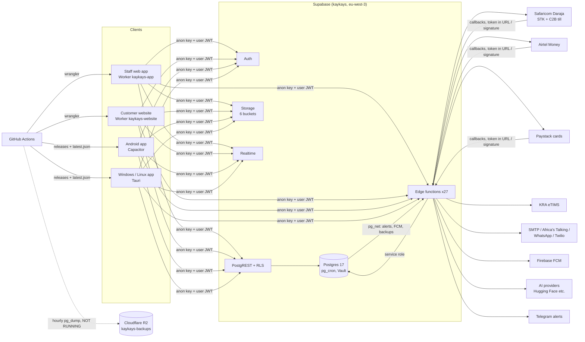

# ISMS architecture (current state)

Phase 0 baseline of the [production readiness plan](../ISMS_Production_Readiness_Master_Checklist.md), recorded 2026-11-23 from the repository, the live Supabase project and the live Cloudflare Workers. Status of the whole effort: [production-readiness.md](../production-readiness.md).

## Contents

1. [Summary](#1-summary)
2. [Diagram](#2-diagram)
3. [Applications](#3-applications)
4. [Supabase](#4-supabase)
5. [Cloudflare](#5-cloudflare)
6. [Third-party integrations](#6-third-party-integrations)
7. [Environments](#7-environments)
8. [Secrets inventory (names only)](#8-secrets-inventory-names-only)
9. [CI/CD](#9-cicd)
10. [Tests, monitoring, backups](#10-tests-monitoring-backups)
11. [Known unknowns and access needed](#11-known-unknowns-and-access-needed)

## 1. Summary

- **One backend: Supabase** (project `kaykays`, ref `orhryivuocsjxkwbhfni`, region eu-west-3, Postgres 17). Postgres holds all business logic: 142 tables, 14 views, 509 functions, 242 RLS policies, 11 `pg_cron` jobs. 27 edge functions (Deno) handle payments, messaging, AI and webhooks.
- **No server of our own.** The staff app and the customer website are static Vite + React builds. Each is served by a **Cloudflare Worker with static assets only** (no Worker code), with SPA fallback.
- **Clients:** web (Cloudflare), Android (Capacitor 8), Windows/Linux (Tauri 2). All of them use the same `dist/` build and talk straight to Supabase with the publishable (anon) key and the user's JWT.
- **Multi-tenant:** every business row has a `business_id`. Access is decided by `business_memberships` + `role_permissions` through `has_permission()` / `assert_permission()`, both in RLS and inside `SECURITY DEFINER` functions.

## 2. Diagram

## 3. Applications

| App | Code | Build | Runtime needs | Served by |
|---|---|---|---|---|
| Staff app | `src/` | `npm run build` → `dist/` (Vite 6, React 19, Tailwind 4) | Static SPA. Client-side routing. ONNX background remover loads its 27 MB wasm from jsDelivr on web (`VITE_ORT_WASM_FROM_CDN=1`) | Worker `kaykays-app` ([wrangler.jsonc](../../wrangler.jsonc)) |
| Customer website | `website/` | `npm run website:build` (Vite + prerender script) | Static, prerendered pages | Worker `kaykays-website` (`website/wrangler.jsonc`) |
| Android | `android/` | Capacitor sync of `dist/` | Native plugins (camera, notifications, alarms, ML Kit) | GitHub releases, auto-update |
| Desktop | `src-tauri/` | Tauri 2 (Rust 1.99.1 pinned) | Native ORT, updater | GitHub releases (`latest.json`) |

No SSR, no server routes and no Node runtime features are needed, so Workers static assets is the right Cloudflare product ([HOSTING_CLOUDFLARE.md](../HOSTING_CLOUDFLARE.md)). Pages would also work but adds nothing.

## 4. Supabase

| Part | Use |
|---|---|
| Database | All data and business rules (sales, stock, books `acc_*`, money `money_assets`, payroll, loyalty, promotions). Money columns `numeric(14,2)`. |
| Auth | Email + password, own OTP codes (`auth-otp` function + `otps` table), Google sign-in optional. Phone logins for the website. No MFA. |
| Storage | `product-images`, `business-logos`, `employee-avatars` (public read), `business-files`, `expense-receipts`, `receipt-exports` (private). Size and type limits per bucket; writes scoped to the business folder. |
| Realtime | 23 channel subscriptions in the app (orders, notifications, presence, alerts). |
| Edge functions | 27 deployed: 25 in the repo, plus `kim-chat` and `shared`, which are old and no longer in the repo. 17 skip the gateway JWT check and do their own checks: callbacks (token or signature), webhooks (shared secret), `requirePermission`. |
| Cron (`pg_cron`) | auto-clock-out, buying-nightly, customer-portal-daily, escalate-unaccepted-alerts, expire-promotion-holds, process-schedule-reminders, prune-stale-device-tokens, referral-and-promotion-jobs, ring-regular-orders, run-due-backups. |
| Vault | `project_url`, `service_role_key`, `fcm_webhook_secret` (used by triggers that call edge functions). |

Migrations: `supabase/migrations/`. The 82 historical files were squashed into `20261120001` + `20261120002` on 2026-11-16. As of 2026-11-23 every file through `20261201001` has been applied on live.

## 5. Cloudflare

| Product | Used | Notes |
|---|---|---|
| Workers (static assets) | Yes | `kaykays-app`, `kaykays-website` on `*.kimanthidennis02.workers.dev`. Blue-green: `versions upload` → smoke test → `versions deploy` ([scripts/deploy-web.sh](../../scripts/deploy-web.sh)). |
| R2 | Planned | Bucket `kaykays-backups` for encrypted DB dumps. No credentials set, so nothing is stored yet. |
| DNS / custom domain | Not yet | `kaykays.com` / `app.kaykays.com` routes are commented out in wrangler config. |
| WAF, rate limiting, Turnstile | Not used | Nothing to protect at the edge yet: there is no Worker code, and the API traffic goes straight to Supabase. Re-assess when a custom domain is attached. |
| Vercel | Removed | Config deleted on 2026-11-14. Only `.gitignore` entries remain. |

Headers come from `public/_headers` and `website/public/_headers`: CSP, HSTS 2 years, `X-Frame-Options: DENY`, nosniff, Referrer-Policy and Permissions-Policy. `/assets/*` is cached immutably; `index.html` is served with `max-age=0, must-revalidate`. Verified live on 2026-11-23.

## 6. Third-party integrations

| Service | Purpose | Where configured | Live status |
|---|---|---|---|
| Safaricom Daraja | M-Pesa STK prompts, C2B till confirmations | Per business in DB; `MPESA_CALLBACK_TOKEN` secret | Callback secret not set, so callbacks are refused. Untested against Daraja. |
| Airtel Money | Payment prompts | Per business (`airtel_payment_secrets`, callback token per business) | Untested |
| Paystack | Card payments | Per business (`card_payment_secrets`), webhook signature | Untested live |
| KRA eTIMS | Tax receipts | Per business (`kra_etims_secrets`) | Untested against sandbox |
| SMTP | Email (codes, invitations, customer messages) | `SMTP_*` function secrets | Set |
| Africa's Talking | USSD, SMS | Per business | Unknown |
| WhatsApp Cloud / Twilio | Messages | Per business | Unknown |
| Firebase FCM | Push | `FIREBASE_SERVICE_ACCOUNT`, `FCM_WEBHOOK_SECRET` | Set |
| Hugging Face (+ other AI APIs optional) | Assistant, advisors | `HF_TOKEN_A/B`; per-business keys in `ai-config` | Set |
| Telegram | Ops alerts | `TELEGRAM_*` (functions + GitHub) | Live, tested 2026-11-15 |
| Google APIs | Owner backups to Sheets/Drive (`backup-config`) | Per business OAuth | Unknown |
| Unsplash | Picture search in uploader | `VITE_UNSPLASH_ACCESS_KEY` (public by design) | Set |
| jsDelivr | ONNX wasm for web background remover | Build flag | Live |
| GitHub releases | App installers + auto-update | `RELEASE_TOKEN`, Tauri signing key | Live |

## 7. Environments

| Environment | Database | Web | Notes |
|---|---|---|---|
| Production | Supabase `kaykays` | Workers on workers.dev | 2 businesses, 2 users (2026-11-23). |
| Staging | None | Cloudflare preview URLs per uploaded version | **No staging database.** Preview builds talk to the production database. |
| Local / test | Docker Supabase stacks (`isms-seedtest`); throwaway `promo_test` DB built from migrations | `npm run dev` | DB test suites run here (`supabase/tests/`). |

Other projects in the same Supabase account (`FluencyTalks`, `wakiambu`, `mybusiness`) are unrelated to ISMS.

## 8. Secrets inventory (names only)

| Where | Names |
|---|---|
| Supabase function secrets | FCM_WEBHOOK_SECRET, FIREBASE_SERVICE_ACCOUNT, HF_TOKEN_A, HF_TOKEN_B, HUGGING_FACE_TOKEN, SMTP_HOST, SMTP_PASS, SMTP_PORT, SMTP_USER, TELEGRAM_BOT_TOKEN, TELEGRAM_CHAT_ID, plus the platform-provided SUPABASE_* keys. **Not set:** MPESA_CALLBACK_TOKEN. |
| Supabase Vault | project_url, service_role_key, fcm_webhook_secret |
| Database tables (service role only) | airtel_payment_secrets, card_payment_secrets, kra_etims_secrets, whatsapp_settings, AI/SMS provider keys |
| GitHub Actions | ANDROID_KEYSTORE_*, ANDROID_KEY_PASSWORD, APP_URL, CLOUDFLARE_ACCOUNT_ID, CLOUDFLARE_API_TOKEN, GOOGLE_SERVICES_JSON, RELEASE_TOKEN, SUPABASE_ANON_KEY, SUPABASE_URL, TAURI_SIGNING_PRIVATE_KEY(_PASSWORD), TELEGRAM_BOT_TOKEN, TELEGRAM_CHAT_ID, VITE_AI_NAME, VITE_UNSPLASH_ACCESS_KEY. **Not set:** SUPABASE_DB_URL, BACKUP_PASSPHRASE, R2_ACCESS_KEY_ID, R2_SECRET_ACCESS_KEY. |
| Developer machine (untracked) | `.env` (URL, publishable key, SMTP, keystore path/alias/password), `my-release.keystore` |
| Browser bundle | Only `VITE_*` values: Supabase URL, publishable key, Unsplash key, names. No service-role or secret key was found in `dist/`. |

## 9. CI/CD

| Workflow | Trigger | Does |
|---|---|---|
| `build.yml` | push, PR | Builds the apps |
| `release-and-deploy.yml` | push to main (version change), manual | Builds installers, GitHub release, then `deploy-web.yml` |
| `deploy-web.yml` | called | Blue-green deploy of both Workers |
| `rollback-web.yml` | manual | `wrangler rollback` |
| `backup-database.yml` | hourly | Encrypted `pg_dump` to R2. **Failing: secrets missing.** |
| `restore-drill.yml` | Mondays | Restores the newest backup in CI. **Never ran** (no backups). |

`main` has no branch protection. The repository `KIMGITO/ISMS` is public.

## 10. Tests, monitoring, backups

- **Unit tests:** `npm test` (72 pass). **Typecheck:** `npm run lint`, `npm run website:lint` (clean).
- **DB tests:** `supabase/tests/*` (6 suites, 288 checks, all passing on 2026-11-23). `grants_check.sql` + `scripts/check-live-grants.sh` check access rules, including on live.
- **Monitoring:** Telegram alerts from CI and from `ops-alert` (crash reports, admin problem reports). `ops-alert` GET works as a health URL, but no external uptime monitor is set up. Workers observability is on.
- **Backups:** see [BACKUP_AND_RECOVERY.md](../BACKUP_AND_RECOVERY.md). The Supabase plan's own backups are not verified, and the independent hourly backup is not running.

## 11. Known unknowns and access needed

| Unknown | Needed from |
|---|---|
| Supabase plan, daily backups / PITR availability and retention | Owner: Supabase dashboard → Billing, Database → Backups |
| Live Auth settings: password policy, leaked-password check, MFA, CAPTCHA, rate limits, redirect URLs | Owner: dashboard → Authentication (the CLI token here is in the keyring, so the Management API can't be read from scripts) |
| Cloudflare plan and account security (2FA, token scopes) | Owner: Cloudflare dashboard |
| Whether any shipped Android build used the pre-2.0.0 key that is still fetchable in public Git history | Owner |
| Payment providers' production credentials and callback URLs | Owner, per business |
